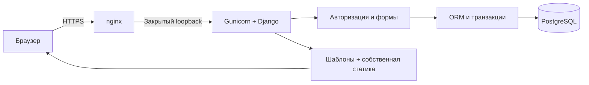

# Архитектура и продуктовые решения

## Задача и допущения

Гипотеза: студенту полезнее видеть ближайшее действие и причину, чем набор несвязанных метрик. Интервью и пользовательское исследование не проводились. Название «Пульс Кампуса» и РТУ МЕМРЭА вымышлены; реальные университетские системы не подключены.

Django выбран вместо FastAPI, потому что проекту нужны серверные формы, административная панель сотрудника, сессии, CSRF и миграции. Эти возможности входят в один поддерживаемый фреймворк. Python 3.12, Django 5.2 LTS; точные версии в `requirements.lock`. PostgreSQL — постоянное хранилище production; SQLite — автономная локальная демонстрация.

## Поток запроса

Это модульный монолит. Отдельных микросервисов, SPA, фонового ИИ, очередей и публичного JSON API нет. HTML-эндпоинты тоже проверяют права сервером. Уведомления читаются в приложении; push/email не реализованы.

## Модель данных

| Сущность | Назначение и связи |
| --- | --- |
| Django User | Хеш пароля, активность, права сотрудника |
| Profile | Один профиль пользователя, ФИО, факультет, направление, курс, группа, номер билета |
| Group | Группа с собственным расписанием |
| Discipline | Название дисциплины |
| Lesson | Группа, дисциплина, дата/время, тип, аудитория, преподаватель |
| Поля изменения Lesson | Отмена, прежние время/аудитория и пояснение; отдельный журнал редакций расписания не нужен прототипу |
| LearningResult | Пользователь, дисциплина, состояние результата, оценка или дата экзамена |
| Deadline | Задача текущего студента, срок и личная отметка выполнения |
| StudentRequest | Владелец, тип, содержание, статус, уникальный ключ повторной отправки |
| RequestHistory | Статус, время, комментарий и автор изменения заявки |
| Announcement | Общее вымышленное объявление |
| Notification | Адресат, категория, текст, необязательная ссылка на объявление/заявку и индивидуальное `read_at` |
| LoginThrottle | Хешированный ключ ограничения входа и счётчик окна |

Внешние ключи и ограничения БД защищают связи. Время окончания занятия должно быть позже начала. Пятибалльная оценка хранится только у состояния «Оценка»; иные состояния не превращаются автоматически в долг.

## Основные сценарии

**Заявка.** Студент заполняет форму → сервер валидирует → экран проверки → подтверждение → транзакционное сохранение заявки, истории и уведомления. Владелец берётся из сессии. Подписанный токен формы привязан к пользователю, имеет срок и уникальный UUID. Повторное подтверждение возвращает уже созданную запись. Конфликт повторного токена с другим содержимым показывает ошибку.

**Работа сотрудника.** Встроенная Django admin проверяет активность, `is_staff` и разрешения модели. Сотрудник меняет статус, при уточнении/отказе пишет обязательный комментарий. История и персональное уведомление появляются в той же транзакции. Студент может ответить на уточнение, но не выбрать служебный статус.

**Расписание.** Дата проекта — `Europe/Moscow`, без подмены «сегодня» фиксированной датой. Режим дня и недели, переходы, пустые дни, отмены и значения до/после изменения. Занятия выбираются по группе профиля, а не по `user_id` из запроса.

**Успеваемость.** Пять состояний: оценка, зачёт, ожидаемый результат, нет данных, задолженность. Среднее — простое арифметическое только записанных пятибалльных оценок; зачёты и отсутствие данных не входят. Пользовательская отметка выполнения дедлайна не меняет официальную оценку.

**План на сегодня.** Детерминированные правила объединяют оставшиеся занятия, задания со сроком сегодня/ранее и обращения, требующие ответа. Каждый пункт содержит фактическую причину и ссылку. Это алгоритм, а не нейросеть или официальный совет деканата.

## Интерфейс

Пять разделов: главная, расписание, успеваемость, заявки, профиль. Уведомления доступны из общего интерфейса. На телефоне — нижняя навигация. Собственная графика, системные шрифты, спокойная основа и один выразительный акцент. Значение статуса передаётся текстом; действия работают без hover.

## Границы

Прототип не заменяет промышленную вузовскую систему. Нет интеграции с реальным расписанием, электронной подписи, официальной выдачи справок, файлового скачивания, почтовой доставки, восстановления пароля и публичной регистрации. Seed-данные поддерживает демонстратор. Нагрузочное тестирование и юридическая аттестация не проводились.
