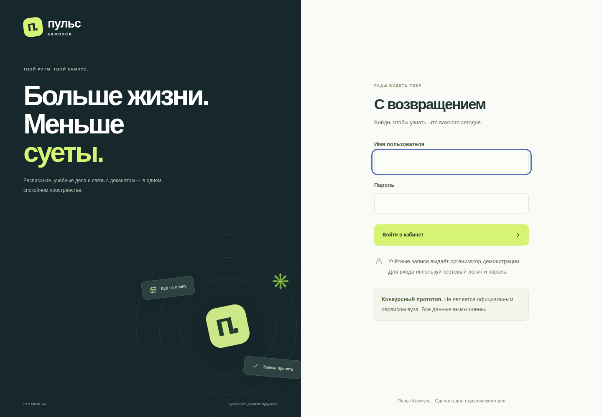
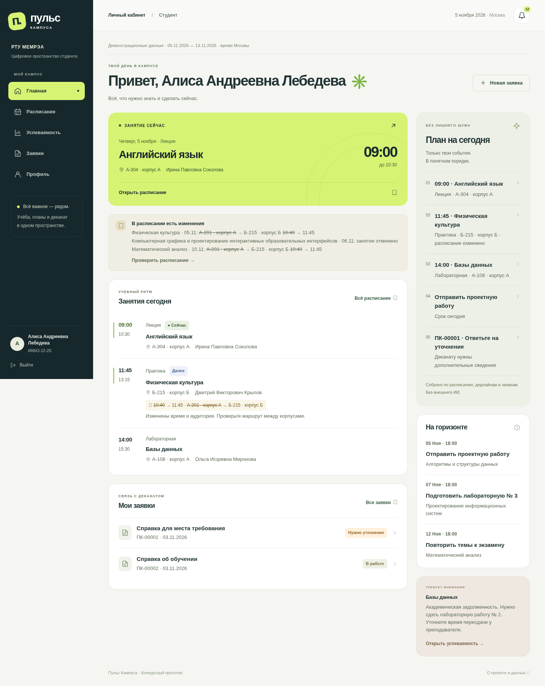
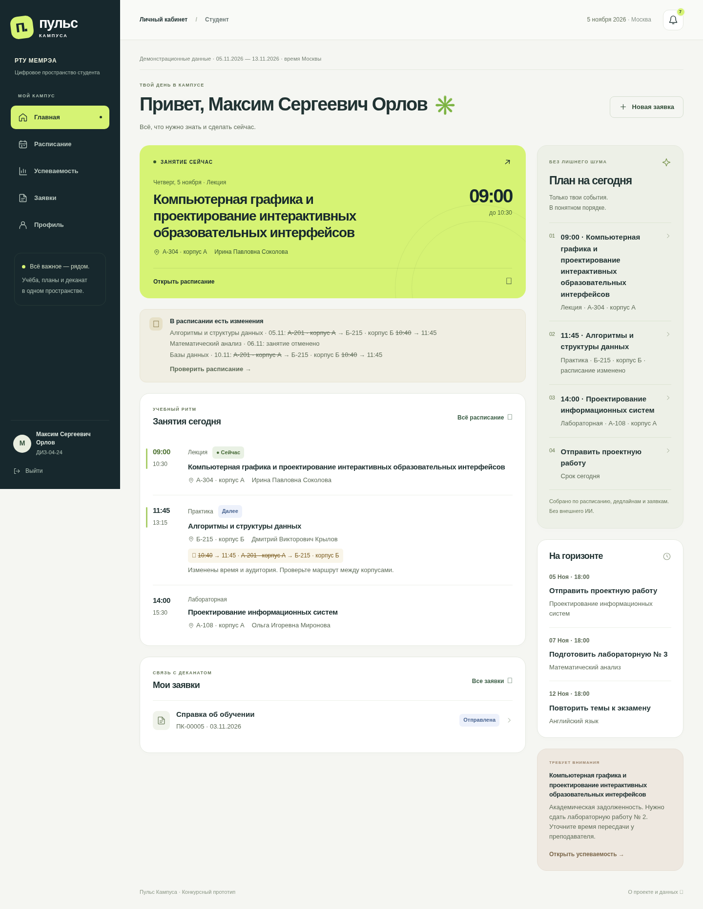
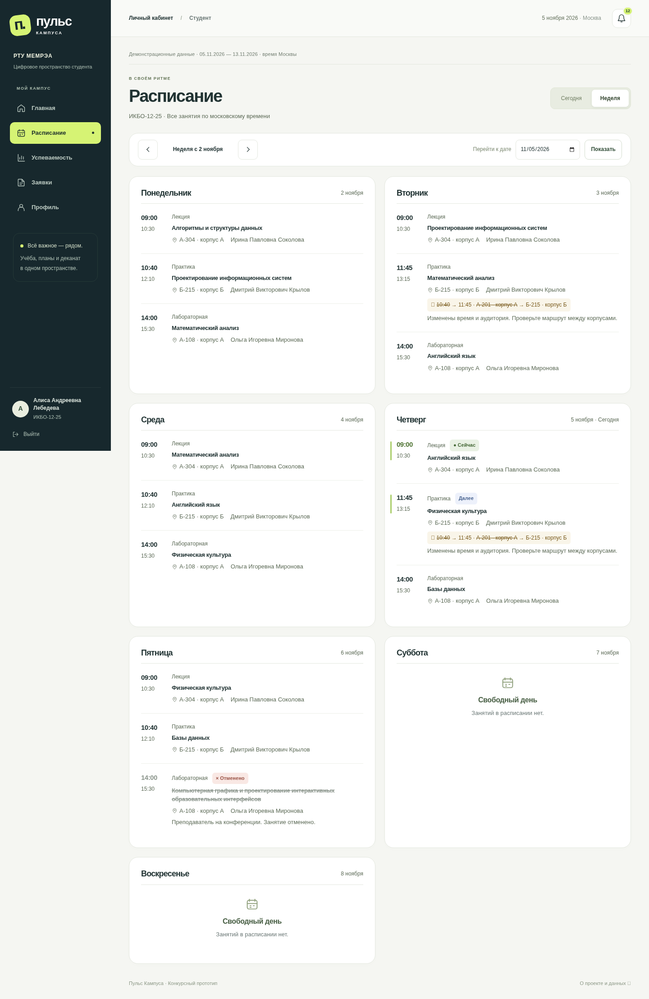
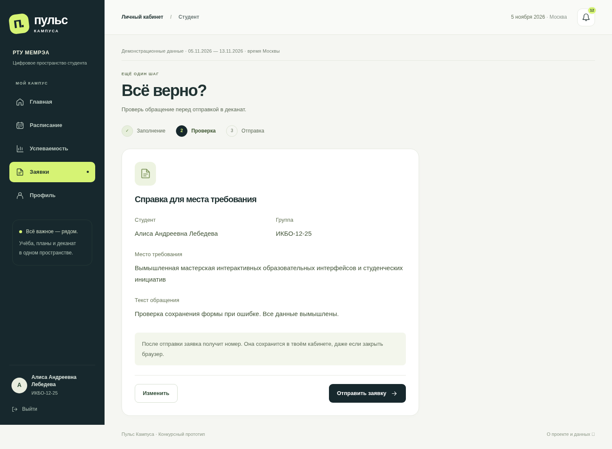
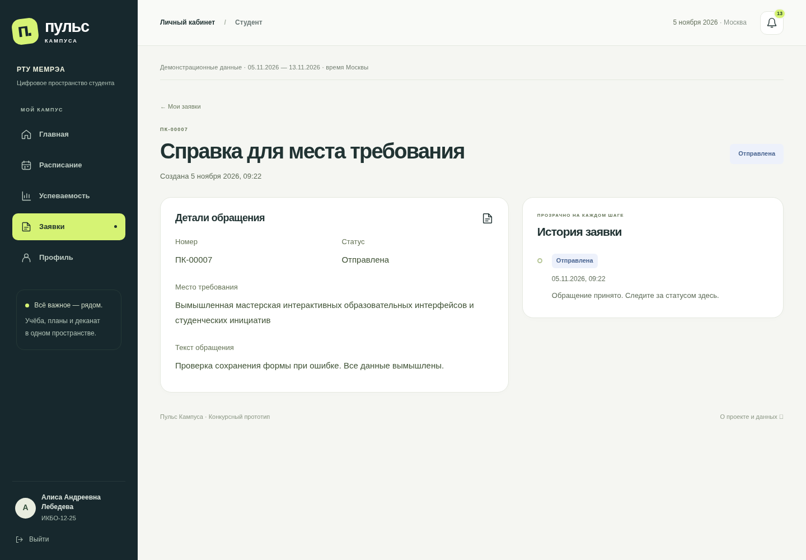
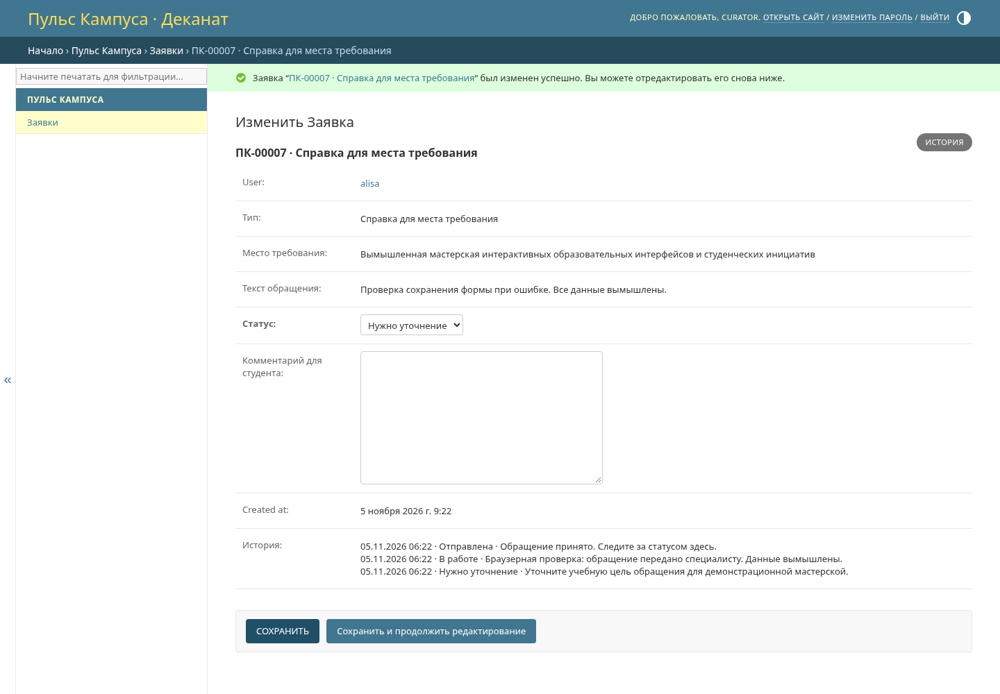
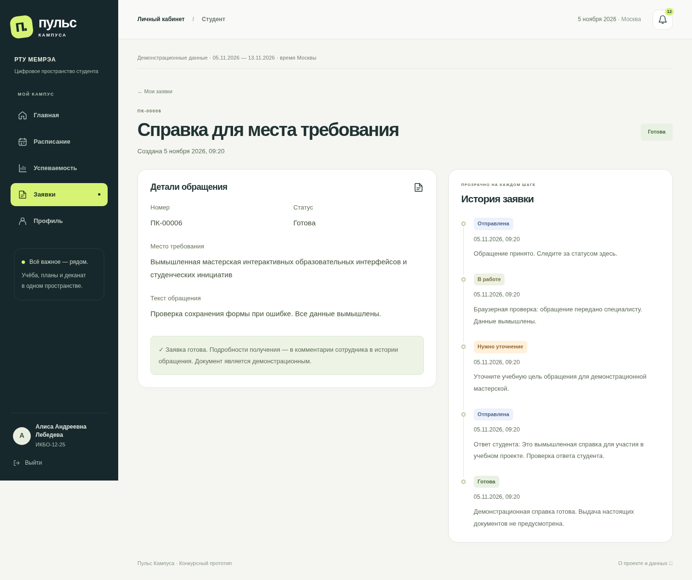
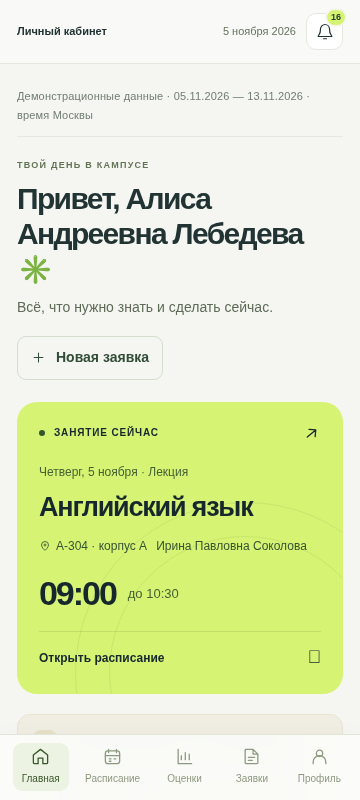
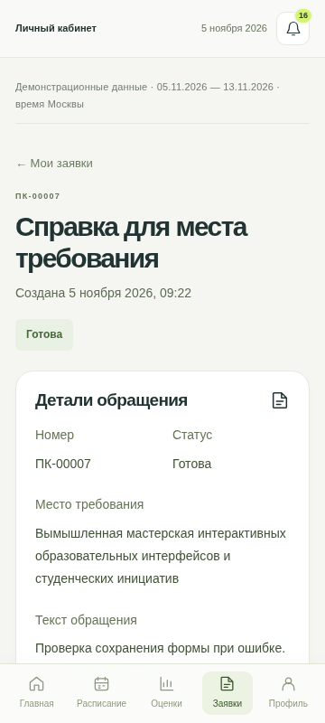

# Пульс Кампуса — описание процесса и доказательства

**Конкурсный прототип. Не является официальным сервисом вуза. Все данные вымышлены.**

Этот документ — исходный отчёт для жюри с реальными результатами и скриншотами. HTML и PDF фактически сформированы и проверены: PDF содержит 15 страниц A4. `scripts/export_report.py` воспроизводит HTML/PDF из этой версии и проверяет загрузку всех изображений. Наличие исходного документа само по себе не означает успешный экспорт: проверяется фактически созданный PDF.

## 1. Проблема и логика разделов

Гипотеза проекта: студенту нужен единый ответ на вопрос «Что мне нужно знать и сделать сейчас?». Главная объединяет ближайшее занятие, изменения, дедлайны и действия по заявкам. Расписание раскрывает время и место; успеваемость отделяет результат от долга; заявки дают прослеживаемое обращение; профиль объясняет, чьи данные показаны. Это проектная гипотеза, не результат интервью.

## 2. Сценарии

Вход → обзор дня → просмотр изменения расписания → создание обращения → проверка ввода → номер и история → уточнение сотрудника → ответ студента → готовность. Второй студент видит собственные записи. Прочтение персонального уведомления не меняет состояние другого пользователя. Выход закрывает доступ.

## 3. Использованные инструменты

Codex и его параллельные агенты помогали с проектированием, кодом интерфейса, документацией, тестами и браузерной проверкой. Shell/Python/Git использовались для реального исполнения, pip/PyPI — для зависимостей. Django test runner запускал серверные проверки, Playwright управлял настоящим Chromium. Основной агент отвечает за интеграцию. Отдельная IDE, интервью и внешние вузовские сервисы не заявляются. Подробности и ключевые запросы — в `ai-process.md`.

## 4. Ключевые решения и ошибки

Выбран Django-монолит: встроенные сессии, формы, CSRF и admin сокращают количество собственных механизмов безопасности. SQLite упрощает локальный запуск; production требует PostgreSQL. Алгоритмический план не зависит от генеративного API.

Первая Git-проверка упёрлась в доступ к proxy; разрешённое исполнение подтвердило рабочий доступ и действительно пустой репозиторий. Секрет GitHub не запрашивался. Пустой репозиторий стал основанием создать новый проект после нового задания. Для публичной публикации подготовлены файлы, но отсутствие хостинга и домена не скрывается.

## 5. Архитектура и защита простыми словами

Браузер отправляет формы на сервер Django. Сервер определяет пользователя по сессии и сам ограничивает выборку данными этого студента. Подмена ID не должна давать чужие записи. Пароль хранится как стандартный хеш; служебный статус меняется только сотрудником. Форма защищена от сторонней отправки, текст выводится с экранированием. Повторное подтверждение одной заявки не создаёт случайный дубликат.

В production запрос проходит через HTTPS/nginx к закрытому Gunicorn, данные хранятся в постоянной PostgreSQL. Подробнее — `architecture.md` и `security.md`.

## 6. Фактические проверки

5 ноября 2026 года основной агент выполнил **31 тест из 31 успешно** на SQLite и тот же набор **31 из 31** на PostgreSQL 17 в реальном контейнере. Выполнены миграции пустых БД (включая `0002`), `seed_demo` и Django system check. На SQLite выполнен `collectstatic`. Это результаты текущего экземпляра, а не доказательство публичного развёртывания.

В `portal/tests.py` проверены: правильный/неправильный вход, закрытые страницы и выход; безопасный login redirect; подмена ID, владельца, роли и статуса; три типа заявок, валидация с сохранением текста, повтор отправки и подписанный токен; независимое прочтение; CSRF и escaping; права сотрудника, комментарии и ответ на уточнение; расписание по группе, изменения, current/next; среднее только по оценкам; rate limit и его истечение; ограничения числовой оценки в БД; повтор seed без потери паролей, заявок и прочтения.

| Проверка | Результат |
| --- | --- |
| Миграции чистой БД | Проверено: SQLite и PostgreSQL 17, `0001` + `0002` |
| Django system check | Проверено: SQLite и PostgreSQL 17 |
| Сборка статики `collectstatic` | Проверено на SQLite-окружении |
| Автоматизированные сценарии | Проверено: 31/31 на SQLite и 31/31 на PostgreSQL |
| Два студента в браузере | Проверено: разные имена/группы/результаты; чужая заявка HTTP 404 |
| Сотрудник и изменение статуса | Проверено: «В работе» → «Нужно уточнение», обязательный комментарий, ответ студента, «Готова» и пять записей истории |
| Телефон 360 px | Проверено: вход, пять разделов, уведомления и формы; горизонтального скролла нет, нижняя навигация работает |
| Данные после перезапуска | Проверено: реальный stop/start dev.sh, новый вход; ПК-00006 сохранила место требования, «Готова» и пять записей истории |
| Docker-сборка и Gunicorn | Проверено: чистая сборка Python 3.12.14-slim, непривилегированный контейнер, реальная PostgreSQL 17; успешный вход и главная |
| Production-настройки | Проверено: `check --deploy` без замечаний; Secure, HttpOnly, SameSite=Lax; HTTP 301 на HTTPS |
| Чистое окружение | Проверено: из чистого образа на отдельной пустой `campus_clean` миграции, seed дважды и `check --deploy`; Compose `config --quiet` |
| Публичный HTTPS и сеть России | Не проверено; нужен сервер владельца |

Контейнер PostgreSQL использовал официальный `postgres:17-bookworm`, digest `sha256:839fbb5a4942a7758dd93e18b42ea5649807491a0545b5eeeb8f0b8bb11857a5`. Он закреплён в Compose. Приложение собиралось из `python:3.12.14-slim` и запускалось через Gunicorn непривилегированным пользователем. Для pip в управляемой сети применён доверенный CA bundle через BuildKit secret; проверка TLS не отключалась.

Production-проверка выполнялась **локально**, с заголовком доверенного прокси `X-Forwarded-Proto: https`: это подтвердило поведение приложения и флаги cookies, но не настоящий публичный TLS, DNS или сертификат. Именно внешний HTTPS остаётся задачей развёртывания.

Окончательный браузерный запуск завершён 5 ноября 2026 в **09:22 МСК**: Playwright + Chromium 155.0.8059.79 в управляемом Linux-окружении. Успешны все **13 групп сценариев**: перезапуск и сохранность, неверный/правильный вход, клавиатурный фокус, оба студента, недельное расписание и пустой день, состояния успеваемости, валидация с сохранением текста, проверка/редактирование/отправка/повторное открытие заявки, полный цикл сотрудника, уведомления, девять мобильных экранов, чужой URL и выход. JavaScript-ошибок страницы и неудачных запросов ресурсов в завершённом запуске нет. Ожидаемые 422 при валидации и 404 при чужом ID проверены отдельно. Подробности — в [браузерном протоколе](browser-checks.md).

Первый браузерный прогон остановился на неточном тестовом селекторе: он искал слово «Было», хотя интерфейс показывал старое значение зачёркнутым и стрелку. Селектор исправлен под реальный экран, затем весь сценарий пройден заново. Отдельно при серверных тестах исправлен расчёт следующего занятия при текущем и заменён неправильный способ проверки cookie после `force_login` на настоящий HTTP-вход. Ошибки доказательств не скрыты и не выдаются за дефекты продукта.

## 7. Скриншоты

Все изображения ниже — настоящие снимки работающего приложения на этапе завершённого ядра. Они не реконструируют более раннюю историю разработки. Данные вымышлены; секреты не показаны. Мобильные изображения сняты браузером при viewport 360 px, а не на физическом телефоне.

### Вход и маркировка прототипа

### Главная Алисы: ближайшее занятие и план

### Главная Максима: другой студент и группа

### Расписание с изменениями

### Проверка данных перед отправкой

### Сохранённая заявка и история

### Сотрудник: защищённое изменение статуса

### Завершённый цикл: ответ студента и готовность

### Сохранность после реального перезапуска

### Мобильная главная, ширина 360 px

### Мобильная заявка, ширина 360 px

## 8. Действия человека

Пользователь выбрал репозиторий, запросил настройку окружения и передал ТЗ. Другие ручные действия в сессии не подтверждены. Раздел `manual-work.md` отделяет сделанное от будущих задач.

## 9. Ограничения и следующие шаги

Нет реальной вузовской интеграции и официальных документов. Нужны публичное HTTPS-развёртывание, резервная копия с проверенным восстановлением, проверка из российской сети и официальных конкурсных сроков. Срок работы и дедлайн подачи в предоставленных требованиях не указаны. Конкурсная заявка не отправлялась. Список необходимых действий — в `submission.md`.

Дополнительно сохранены два настоящих снимка видимой области 360 × 800 px для читаемости мобильных иллюстраций в PDF. Полные мобильные страницы остаются в `docs/screenshots/`.

## Исправления после ревью — 5 ноября 2026

Исправлены четыре замечания: общий адресный лимит за nginx, вытеснение будущих дедлайнов просроченными, отсутствие ближайшего занятия после длинного перерыва и неподтверждённая дата конкурса. Просроченные задачи остаются в «Плане на сегодня», будущие отдельно показываются в блоке «На горизонте». Карточка ближайшего занятия не ограничена двумя неделями.

В Compose включён `LOGIN_RATE_LIMIT_AT_PROXY=1`: nginx ограничивает адрес клиента, приложение сохраняет лимит аккаунта. При прямом запуске адресный лимит приложения остаётся включён. Подмена `X-Forwarded-For` не позволяет обойти ограничения. Инструкции развёртывания и безопасности обновлены; устанавливать необходимо весь nginx-конфиг вместе с `map` и `limit_req_zone`.

Новые фактические проверки: 36/36 тестов на SQLite, включая пять регрессионных проверок; `check`, `makemigrations --check --dry-run` и `git diff --check` без замечаний. Выполнены миграции на отдельной пустой SQLite. Chromium прошёл сценарии двух студентов и сотрудника, девять маршрутов на 360 px. После SIGTERM отдельного тестового процесса на порту 8001 и нового запуска с той же БД браузер подтвердил сохранность заявки, статуса «Готова» и пяти записей истории. Эти проверки использовали отдельную демонстрационную БД; предыдущие скриншоты в репозитории не перезаписывались.

Конфигурация nginx проверена настоящим nginx в изолированном контейнере: `nginx -t`, общий лимит POST-входов студента и сотрудника (включая query string), 429 после 40 запросов с одного IP, успешный запрос другого IP, отсутствие обхода через подмену заголовка, доступность GET и POST вне входа. Использовались два loopback-IP, локальный тестовый сертификат с проверкой доверия и тестовый backend. Это не проверка публичного домена или настоящего production TLS.

HTML и PDF пересобраны из исправленного Markdown. Production PostgreSQL, публичный HTTPS и восстановление резервной копии в ходе этих исправлений повторно не проверялись; прежние результаты выше относятся к предыдущему этапу.
